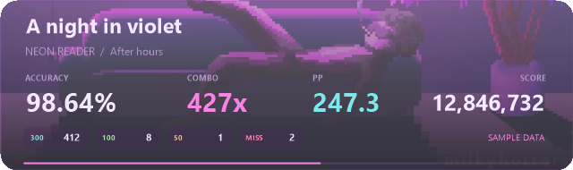

# Myosu! PP Counter/Overlay

A compact Windows overlay and independent memory reader for **osu! stable**.
Live accuracy, combo, score, hit counts and performance points over an animated
neon background. No tosu installation or server is required.

## Download and run

Download [the portable Windows ZIP](https://github.com/Momoq12/myosu-pp-counter-overlay/releases/latest/download/Myosu-PP-Counter-Overlay.zip),
extract the entire folder, and open **Myosu.exe**. Keep its assets and
`calculator` folder alongside it. Open osu! stable and select a map.

The portable download includes its offline PP runtime. It needs Windows x64
with .NET Framework 4.x, normally included on Windows 10/11.

## Controls

| Action | Control |
| --- | --- |
| Move | Drag the panel |
| Resize | Drag an edge or corner, or Ctrl + mouse wheel |
| Background transparency | Shift + mouse wheel |
| Separate background and whole-panel visibility | Right-click → Transparency |
| Show or hide | Ctrl + Alt + N |
| Click-through | Ctrl + Alt + C |
| Unlock or show | Double-click the tray icon |
| Quit | Right-click → Quit |

The panel preserves its aspect ratio. Background visibility can be set to zero
while keeping text readable. Position, size and visibility settings save locally.
Use windowed/borderless osu! to keep the desktop overlay visible while playing.

## How it works

The C# reader uses read-only Windows process access and signature scanning to
locate stable's live data. It does not inject code, write game memory, or play
inputs. PP is calculated offline by **rosu-pp-js 4.0.1**, explicitly using
stable scoring, with the selected `.osu` file, mods, hit results and max combo.
PP is an estimate and can differ from servers using another calculator model.

The local feed is available at `http://127.0.0.1:24060/state`; `/` provides a
live viewer and `/health` reports server health. Check `statsAvailable` before
displaying gameplay values. Preview data is labelled and never sent by the API.

## Build from source

Run `prepare.ps1` once to restore the pinned Node runtime (the calculator is included),
then `build.ps1` with PowerShell. Windows' .NET Framework C# compiler is used;
no Visual Studio, .NET SDK, or NuGet restore is required.

`Myosu.exe --self-test` exercises a controlled child process and writes
`test-results.json`. `Myosu.exe --demo` shows explicitly labelled sample data.
See [VERIFICATION.txt](VERIFICATION.txt) for the actual checks and remaining limits.

## Attribution

Source: LGPL-3.0-or-later; third-party notices are in
[THIRD-PARTY.md](THIRD-PARTY.md) and `licenses/`. The supplied background and
character artwork retain their original rights and are not covered by the
software source license. This is an unofficial community project.
